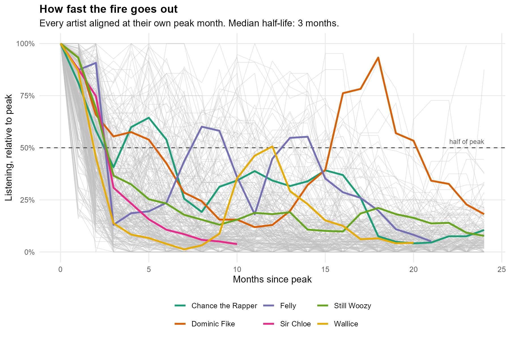

# Listening Half-Life

How long does a musical obsession last? For every artist in a Last.fm listening history, this measures the **half-life**: how many months it takes for listening to fall to half of its peak and *stay* there.



## Key results

Run on my own history (2022 to 2026), for artists with at least 30 plays (331 artists):

- **Median half-life: 3 months.** Of the 296 artists with a measurable decay, most burn out within a quarter.
- **225 "Supernovas"** (half-life 3 months or less), **60 "Steady"** (4 to 11 months) and only **11 "Slow burns"** (a year or more). The slowest were Mac Miller and Lil Nas X at 17 months. The other 35 artists could not be scored (15 had no clear peak, 20 peaked too recently to judge).
- **Later discoveries look faster.** Artists discovered in 2022 had a median half-life of 3 months; those discovered in 2023, 2024 and 2025 all had 2. Part of that is a measurement effect: an artist found recently can only be scored if it has already decayed, so slow burns among recent discoveries are missing. Read it as a hint, not a trend.
- **Genre matters (with small samples).** Of the 200 most-played artists, tagged with their top Last.fm genre: hip-hop 4.5 months (n=20), rap 3.5 (n=14), indie pop and indie rock 3, indie and pop 2. Treat these as suggestive, not conclusive.

## How it works

1. **Pull** scrobbles from the Last.fm API (`01_pull_scrobbles.R`), then build a zero-filled artist-by-month grid (`02_build_monthly.R`).
2. **Smooth** each artist's series with a centred 3-month rolling mean and find the peak month (`03_half_life.R`).
3. **Guard rails** so the number means something: the peak must be at least 2x the artist's median month, and there must be at least 6 months after it to observe a decline.
4. **Half-life** is the first month after the peak where listening is at or below 50% of peak and *stays* there for 3 more months. Artists that never drop that far are left unscored.
5. **Classify** each artist (Supernova, Steady, Slow burn) and compare across discovery years (`04_plots.R`) and genres (`05_genre_halflife.R`).

All thresholds are named constants in `00_config.R`.

## Interactive versions

Hover-and-poke versions of the charts, rendered as standalone HTML:

- [Decay curves](docs/interactive/interactive_decay_curves.html)
- [Burn map](docs/interactive/interactive_burn_map.html)
- [Eras](docs/interactive/interactive_eras.html)

`07_explorer.R` is a small Shiny app for clicking any artist to see its real monthly history with the peak and half-life marked.

## Files

```
00_config.R ... 07_explorer.R   the pipeline, in order
results/half_lives.csv          one row per artist: peak, half-life, status, class
results/genre_half_lives.csv    median half-life by genre tag
figures/                        the four static charts
docs/interactive/               the three interactive charts
```

## Run it yourself

```r
install.packages(c("httr", "jsonlite", "dplyr", "ggplot2", "plotly", "htmlwidgets", "shiny"))
# in .Renviron:  LASTFM_API_KEY=...   LASTFM_USER=your_account
source("01_pull_scrobbles.R"); source("02_build_monthly.R"); source("03_half_life.R")
source("04_plots.R")   # optional: 05_genre_halflife.R, 06_interactive.R, 07_explorer.R
```

## Data and limits

Scrobbles come from the public Last.fm API for my own account; the raw history is not stored in this repo (`data/` is git-ignored). This is one listener's habits at monthly resolution, so it describes a style of listening, not a universal law. A very recent peak cannot be scored yet.

## Stack

R · Last.fm API · ggplot2 · plotly · Shiny

## Related

[Soundings](https://github.com/vjrupp49/lastfm-soundings) maps the same kind of history into a taste space, and [Wake](https://github.com/vjrupp49/lastfm-influence-network) looks at how discovery spreads within a group.

---

Built by Vincent Rupp. Shared for portfolio and review purposes; please get in touch before reusing it.
